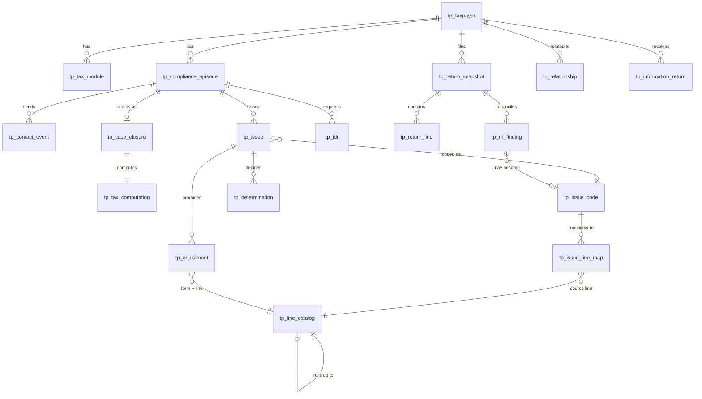

# TP360 + RVE POC — data model (v0.2)

Generated by `tools/make_data_model_doc.py` from the CSV headers. Synthetic data only; POC table names, not CDW names.

## How it fits together

## The issue → MeF line translation

An issue (rule break) never changes a calculated line directly.

1. **`tp_issue_code`** names the issue and its authority (e.g. `EX_SCHC_VEHICLE`, IRC 162 / 274(d)).
2. **`tp_issue_line_map`** says which **source** line(s) it adjusts and how (`SCH_C 9`, DECREASE_DEDUCTION).
3. **`tp_line_catalog`** says where each line rolls up (`SCH_C 9 > SCH_C 28 > SCH_C 29 > SCH_C 31 > SCH_1 3 > SCH_1 10 > 1040 8 > 1040 9 > 1040 11 > 1040 15 > 1040 16 > 1040 24`).
4. The recompute produces the calculated lines, stored as `COMPUTED` rows in `tp_adjustment` and summarized in `tp_tax_computation`.

So every Form 1040 change traces back: 1040 line ← rollup ← source line ← issue code ← issue ← how it was found ← IDR / IRP / RRI finding. `v_issue_to_1040_trace` shows the path for every issue code. This is the same pattern as posting a Form 5701: proposing the adjustment and setting the form/line for recomputation in one step.

## What AIMS holds vs. what this adds

AIMS closed-case data is case level. The closed-case model keeps an AIMS-equivalent record (`tp_case_closure`) and adds the issue, line and computation detail beneath it.

| POC field | AIMS concept (SME to confirm) |
|---|---|
| `tp_case_closure.program` | Examination source / activity |
| `tp_case_closure.outcome` | Disposal code (AIMS disposal codes to be mapped into aims_disposal_code) |
| `tp_case_closure.closed_date, closing_tc` | Closing date; TC 300 / TC 290 posting |
| `tp_case_closure.deficiency, penalty_amount` | Total recommended / assessed deficiency and penalties |
| `tp_case_closure.agreed_ind, appeals_outcome` | Agreed / unagreed; Appeals result |
| `tp_case_closure.total_hours` | Examination hours (time applied) |
| `tp_case_closure.selection_source` | Source / project code of selection |

**Added below the case level (not in AIMS):** issue codes; amount proposed vs. sustained; issue status (adjusted, conceded, no change); how each adjustment was found (`detection_source`: IRP_MATCH, RRI_RECOMPUTE_VARIANCE, RVE_ATTACHMENT_EXTRACT, IDR_RESPONSE, BANK_DEPOSITS_ANALYSIS, THIRD_PARTY_RECORDS, EXAMINER_INTERVIEW); hours per issue; every line adjustment; the full tax computation filed vs. examined; variance root causes.

Interest is computed at assessment and is not modeled. Closed-case computations use TY2024 parameters for illustration.

## Tables

### Taxpayer and account (UCP core spine)

| Table | Purpose | Columns |
|---|---|---|
| `tp_taxpayer` | One row per TIN (masked token). Individuals and entities. | tin_token, tin_type, display_name, entity_type, filing_status, city, state, poa_on_file, case_group |
| `tp_tax_module` | One row per TIN + MFT + tax period: balance, CSED, module status. | module_id, tin_token, mft, tax_period, assessed_balance, last_assessment_date, csed, module_status |
| `tp_compliance_episode` | The canonical case: ACS, IA, OIC, PASSPORT, EXAM, AUR, FIELD_COLLECTION. Open when closed_date is null. | episode_id, tin_token, episode_type, episode_subtype, opened_date, closed_date, status, module_ids |
| `tp_treatment_assignment` | Who owns an episode, and when. | episode_id, function, assignee, start_date, end_date |
| `tp_procedural_overlay` | Conditions that change what treatments may do (OIC pending, Passport certified). | overlay_id, tin_token, episode_id, overlay_type, effect, authority, start_date, end_date |
| `tp_contact_event` | Notices, letters, IDRs, reports — the home of notice history. | contact_id, tin_token, module_ids, episode_id, contact_type, item_code, source_system, statutory_flag, issued_date, delivery_status, response_due, response_received, recipient |
| `tp_statutory_clock` | ASED, CSED, OIC deemed-acceptance and similar clocks. | clock_id, tin_token, module_id, episode_id, clock_type, start_date, expiry_date, suspended_ind, authority |

### Taxpayer 360 context

| Table | Purpose | Columns |
|---|---|---|
| `tp_financial_profile` | Form 433-A (OIC) financial analysis results. | tin_token, as_of_date, gross_monthly_income, allowable_monthly_expenses, net_monthly_ability, net_realizable_equity, minimum_offer, offer_amount, source |
| `tp_asset` | Real property, vehicles, accounts, entity interests; disclosed on the 433-A or not. | asset_id, owner_tin_token, asset_type, description, fmv, encumbrance, equity, disclosed_on_433, source, verified |
| `tp_bank_account` | Accounts from IRP, locator data and the taxpayer's statement. | account_id, tin_token, institution, account_type, acct_last4, balance, source, disclosed_on_433 |
| `tp_information_return` | IRP documents (W-2, 1099s, 1098, K-1). | ir_id, tin_token, tax_year, form_type, box, payer_tin_token, payer_name, amount, note |
| `tp_relationship` | Graph edges: spouse, member, responsible person, owns, manages. | rel_id, from_id, to_id, rel_type, pct, start_date, end_date, source |
| `tp_transfer` | Asset transfers, with consideration and FMV. | transfer_id, asset_id, from_tin_token, to_tin_token, transfer_date, fmv_at_transfer, consideration, source |

### Return Viewer Editor (RVE)

| Table | Purpose | Columns |
|---|---|---|
| `tp_return_snapshot` | Versions of one return: AS_FILED (TC 150), RVE_WORKING, PROPOSED, AS_EXAMINED (TC 300). | snapshot_id, tin_token, mft, tax_period, version_type, basis_snapshot_id, source_tc, created_date, created_by, status |
| `tp_return_line` | One row per line per snapshot, with data_origin (MEF, ATTACHMENT_EXTRACT, RVE_SUPPLEMENT, EXAMINER_ADJUSTMENT, COMPUTED). | snapshot_id, form, line, sub_id, line_desc, mef_element, amount, data_origin, modifiable, review_state |
| `tp_rri_finding` | Reconciliation findings: IRP mismatches and recompute variances, with branch (A/B/C), variance_type and root_cause. | finding_id, snapshot_id, tin_token, tax_period, source, item, irp_amount, return_ref, return_amount, delta, branch, disposition, variance_type, root_cause, issue_code, note |

### Exam work and results (expands AIMS)

| Table | Purpose | Columns |
|---|---|---|
| `tp_issue` | Issue level: issue_code, amount proposed vs sustained, status, how it was found (detection_source), hours. | issue_id, episode_id, tin_token, tax_period, issue_code, description, return_ref, amount_claimed, amount_proposed, amount_sustained, status, detection_source, hours_charged |
| `tp_idr` | Information document requests (Form 4564) with items and response dates. | idr_id, episode_id, tin_token, form, issued_date, due_date, response_date, recipient, status, item_count, items |
| `tp_determination` | Decisions with authority, at issue or episode level. | determination_id, episode_id, issue_id, tin_token, determination_type, outcome, amount, authority, decided_date, detail |
| `tp_adjustment` | Line level: each EXAMINER adjustment to a source line, tied to its issue; COMPUTED rows for the recomputed 1040 lines. | adjustment_id, episode_id, snapshot_id, tin_token, tax_period, form, line, line_desc, as_filed, adjustment, as_adjusted, adjustment_kind, issue_id, issue_code, detection_source |
| `tp_case_closure` | Case level, the AIMS-equivalent record: program, selection source, outcome, closing TC, deficiency, penalty, agreed, hours, Appeals result. | episode_id, tin_token, tax_period, program, selection_source, outcome, closed_date, closing_tc, deficiency, penalty_code, penalty_amount, appeals_outcome, agreed_ind, total_hours, issue_count, adjusted_issue_count, aims_disposal_code, computation_note |
| `tp_tax_computation` | Tax computation results per case, filed vs examined: AGI, taxable income, tax, credits, other taxes, total tax, payments, deficiency. | episode_id, tin_token, tax_period, filing_status_filed, filing_status_examined, agi_filed, agi_examined, taxable_income_filed, taxable_income_examined, tax_filed, tax_examined, credits_filed, credits_examined, other_taxes_filed, other_taxes_examined, total_tax_filed, total_tax_examined, payments_filed, payments_examined, deficiency, penalty_amount, computation_engine, interest_note |

### Reference (the issue -> line translation)

| Table | Purpose | Columns |
|---|---|---|
| `tp_issue_code` | Issue taxonomy: UCP IR codes (IRM 4.19.3 Exh. 4.19.3-9 pattern) and exam issue codes, with IRC authority. | issue_code, issue_name, category, program, source_form, irc_reference, reference_note |
| `tp_issue_line_map` | The translation: issue code -> the MeF source line(s) it adjusts, the effect, and role (PRIMARY / SECONDARY). | issue_code, seq, form, line, mef_element, effect, role, note |
| `tp_line_catalog` | Every line used: element, SOURCE vs CALCULATED, modifiable, and the line it rolls up to. | form, line, line_desc, mef_element, line_class, modifiable, rolls_to_form, rolls_to_line |
| `tp_root_cause` | Variance root-cause categories and their RRI branch. | root_cause, branch, description |

### Run and test

| Table | Purpose | Columns |
|---|---|---|
| `tp_run_params` | as_of_date for the signal rules. | param, value |
| `tp_signal_answer_key` | Expected signals computed independently in Python — the test key. Never give it to Genie. | tin_token, signal_id |

## Views

| View | Answers |
|---|---|
| `v_tp360_header` | One row per taxpayer: balance, open episodes, signals |
| `v_tp_signals` | Rules SG01–SG10 with evidence |
| `v_return_compare` | RVE three-column view: as filed, as adjusted, delta |
| `v_exam_results` | Deficiency per exam episode |
| `v_case_results` | Closed case + tax computation, deficiency per hour |
| `v_line_adjustment_frequency` | Which source lines are adjusted most often |
| `v_issue_outcomes` | Per issue code: raised, adjusted, conceded, no-change %, % of proposed sustained, hours, yield per hour |
| `v_detection_mix` | How adjustments were found |
| `v_variance_root_causes` | Most common variances and their root causes |
| `v_prior_audit_history` | Every closed case per taxpayer, with its issues |
| `v_issue_to_1040_trace` | Issue code → source line → rollup path to Form 1040 |
| `v_related_parties_named` | One- and two-hop relationships with the related party's signals |
| `v_tp_timeline` | Episodes, contacts, snapshots and determinations in one timeline |
